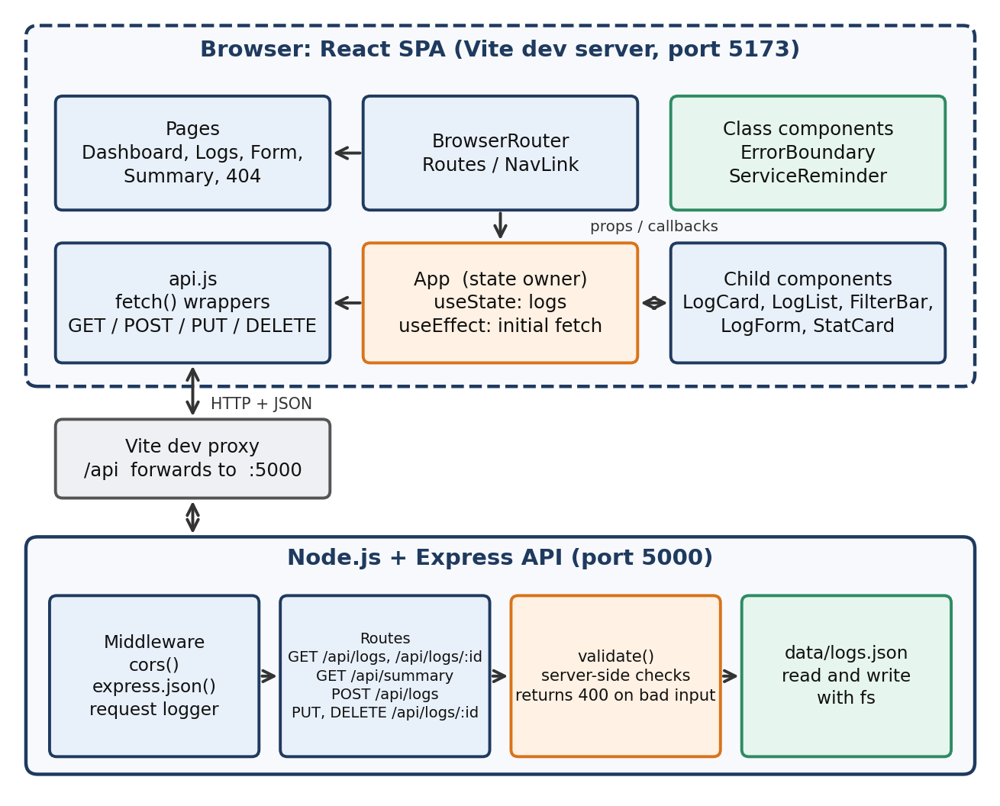
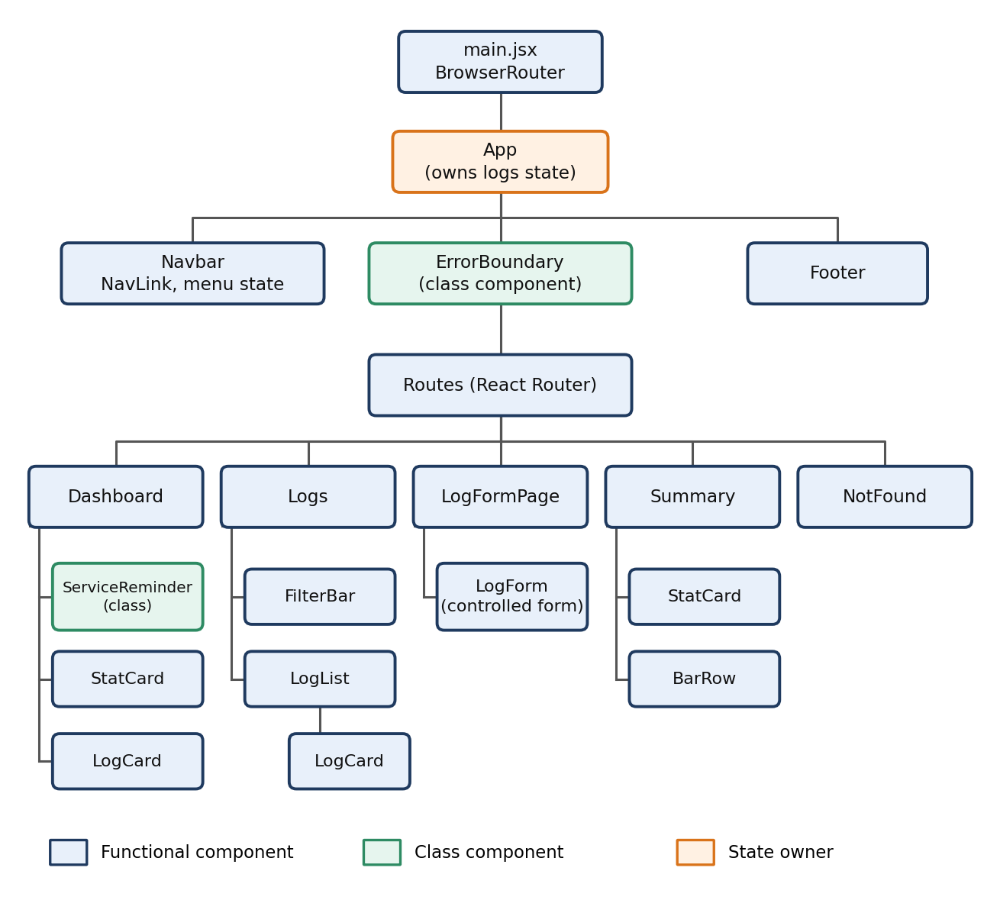

# Gear & Garage Log

A full-stack mini project for **CS3301 Full Stack Development (CIE-2)**. Track service, repair, modification, gear and fuel expenses for your bikes and scooters. React front end, Express REST API, data persisted to a JSON file.

Based on the freeCodeCamp.org "MERN Stack Crash Course – Build a Book Store App" tutorial (https://www.youtube.com/watch?v=-42K44A1oMA). The tutorial's Book CRUD pattern (Express routes, CORS, React Router, Vite) was adapted to a vehicle expense log, and MongoDB was replaced with a JSON file store.

## Features

- Add, view, edit and delete log entries (full CRUD through the Express API)
- Form with live validation: required fields, number checks, no future dates, notes length
- Search, category filter and sorting on the Logs page
- Dashboard with total spend, this month spend, biggest expense and a service reminder
- Spending summary by category and by month, computed by the API
- Client-side routing with 5 views and a 404 page
- Responsive layout with a mobile menu

## Tech stack

React 18, React Router 6, Vite 5, Node.js, Express 4, CORS

## Architecture





## Project structure

```
garage-log/
  package.json            root scripts (setup, dev)
  server/
    server.js             Express app and routes
    data/logs.json        JSON data store (seed data included)
  client/
    vite.config.js        dev server + /api proxy to port 5000
    src/
      main.jsx            entry, BrowserRouter
      App.jsx             state owner, routes
      api.js              fetch wrappers
      utils.js            formatting helpers
      components/         Navbar, Footer, ErrorBoundary, ServiceReminder,
                          StatCard, LogCard, LogList, FilterBar, LogForm
      pages/              Dashboard, Logs, LogFormPage, Summary, NotFound
```

## Run it

Requires Node.js 18.11 or newer.

```bash
npm run setup
npm run dev
```

- Web app: http://localhost:5173
- API: http://localhost:5000/api/logs

On a Mac, if you see `EADDRINUSE ... :5000` (macOS AirPlay Receiver uses port 5000), run `npm run dev:mac` instead. It moves the API to port 5001 and the web app still opens at http://localhost:5173.

## API

| Method | Route | Purpose |
| --- | --- | --- |
| GET | /api/health | Health check |
| GET | /api/logs | List logs (optional `category`, `q`) |
| GET | /api/logs/:id | Single log |
| POST | /api/logs | Create log (validated) |
| PUT | /api/logs/:id | Update log (validated) |
| DELETE | /api/logs/:id | Delete log |
| GET | /api/summary | Totals by category and month |

## React concepts used

| Concept | Where |
| --- | --- |
| Functional components | Every file in `components/` and `pages/` except the two below |
| Class components | `ErrorBoundary.jsx`, `ServiceReminder.jsx` |
| Parent to child props | `App` to pages, `Logs` to `FilterBar` / `LogList` to `LogCard` |
| Child to parent callbacks | `FilterBar` change handlers, `LogForm` `onSubmit`, `LogCard` `onDelete` |
| useState | `App`, `Logs`, `LogForm`, `Navbar`, `Summary` |
| useEffect | `App` (initial fetch), `Logs` (document title), `LogForm` (autofocus), `Summary` (fetch) |
| Event handling | onClick, onChange, onSubmit across the app |
| Form handling | `LogForm.jsx` (controlled inputs + validation) |
| React Router | `main.jsx`, `App.jsx`, `Navbar.jsx` (`NavLink`), `LogFormPage.jsx` (`useParams`, `useNavigate`) |
| Responsive UI | `styles.css` media queries at 800px and 480px |

## Modifications beyond the tutorial

1. Search, category filter and sort controls on the Logs page
2. Dashboard stats and spending summary page (by category and by month) backed by a `/api/summary` endpoint
3. Field-level validation on both client and server (required fields, number checks, no future dates, notes length)
4. Class-based service reminder that shows days since the last service
5. Domain-specific categories, INR formatting and a mobile navigation menu
